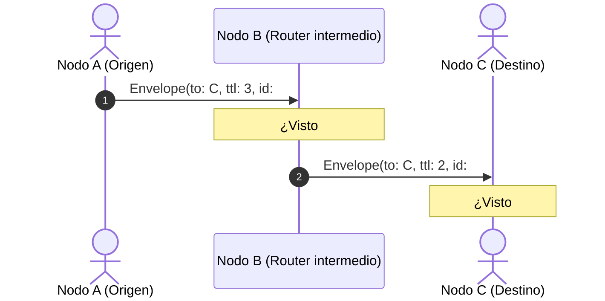

# Arquitectura, Protocolo y Funcionamiento de la Red Mesh B2B (DADM)

Este documento detalla en profundidad los fundamentos teóricos, decisiones de diseño, protocolos de red y detalles de implementación de la aplicación **B2B** (desarrollada en el marco de la cátedra de Desarrollo de Aplicaciones para Dispositivos Móviles - UNPSJB).

---

## 1. ¿Qué hace en sí la aplicación?

**B2B** es una aplicación móvil de mensajería instantánea fuera de línea (*off-grid*) que permite a dispositivos Android comunicarse entre sí sin necesidad de acceso a Internet, datos móviles (3G/4G/5G) ni enrutadores Wi-Fi tradicionales.

Para lograrlo, la aplicación construye una **red ad-hoc descentralizada (Mesh)** punto a punto utilizando las antenas locales del dispositivo (Bluetooth Low Energy / Wi-Fi Direct) a través de la API de **Google Nearby Connections** (estrategia `P2P_CLUSTER`).

### Capacidades principales:
* **Identidad descentralizada:** Cada dispositivo genera un `Node ID` único (UUIDv4) persistido localmente que actúa como dirección física de red.
* **Emparejamiento por QR y Agenda:** Generación de códigos QR con el Node ID, escaneo mediante cámara (`mobile_scanner`) y agenda local persistida en SQLite para asignar alias privados a los nodos.
* **Mensajería 1-a-1 Directa y Multi-hop:** Comunicación privada entre dos nodos específicos. Si los dispositivos no están en rango directo, el mensaje salta a través de nodos intermedios hasta llegar a destino.
* **Mensajería de Emergencia (Broadcast SOS):** Difusión masiva de mensajes de alerta por inundación controlada (*epidemic flooding*) hacia todos los dispositivos alcanzables en la red.
* **Compartir Ubicación Off-grid:** Envío de coordenadas GPS en texto formateado con enlaces directos listos para abrir en mapas al recuperar conectividad o renderizar en visor local.
* **Persistencia local:** Almacenamiento local mediante base de datos relacional SQLite (`sqflite`), manteniendo conversaciones, estados e historiales sin depender de la nube.
* **Operación en Segundo Plano:** Mantenimiento de la red y retransmisión de paquetes mediante un *Foreground Service* nativo de Android con notificación persistente.

---

## 2. Problemáticas que resuelve: Catástrofes naturales y colapso de infraestructura

En situaciones normales, la comunicación moderna depende de una arquitectura centralizada y frágil:
1. **Infraestructura de telecomunicaciones:** Torres de telefonía móvil, antenas de radioenlace y centrales de conmutación.
2. **Suministro eléctrico:** La red eléctrica que alimenta las estaciones base y los módems domésticos.
3. **Servidores centrales e Internet:** Enrutamiento DNS, servidores de WhatsApp/Telegram, cables de fibra óptica submarinos y terrestres.

### El impacto de las catástrofes naturales
Frente a eventos como **terremotos, inundaciones, tornados, erupciones volcánicas o incendios forestales**, la infraestructura convencional colapsa de forma casi instantánea:
* Caída física de torres celulares o cortes en el tendido eléctrico.
* Saturación extrema por congestión del espectro cuando millones de personas intentan comunicarse al mismo tiempo.
* Cortes de fibra óptica por deslizamientos de tierra o fuego.

### La solución de B2B
En este escenario de aislamiento total y "apagón comunicacional", **B2B convierte a cada teléfono inteligente en una torre de transmisión autónoma y repetidor de señales**. 
* **Cero dependencia externa:** No requiere servidores, cables, chips SIM con saldo, ni contraseñas de red.
* **Resiliencia distribuida:** La caída de uno o varios teléfonos no destruye la red; los caminos de comunicación se reconfiguran dinámicamente de forma oportunista.
* **Coordinación comunitaria inmediata:** Permite a vecinos, brigadistas, médicos y rescatistas enviar pedidos de auxilio urgente, coordinar puntos de evacuación y compartir ubicaciones críticas usando únicamente la energía residual de las baterías de sus teléfonos.

---

## 3. La "frontera" de la aplicación: La densidad de nodos y el factor humano

En una red mallada descentralizada ad-hoc, **no existen servidores centrales ni repetidores fijos dedicados**. Por lo tanto:

> **La frontera y alcance máximo de la aplicación está determinado estrictamente por la presencia y densidad física de las personas portando la aplicación.**

* **Topología dependiente del usuario:** Una antena Bluetooth LE o Wi-Fi Direct tiene un alcance físico típico que oscila entre los **10 y 100 metros** (dependiendo de obstáculos, paredes y potencia de transmisión).
* **Sin nodos intermedios, el mensaje no viaja:** Si el Nodo $A$ desea enviar un mensaje al Nodo $C$ que se encuentra a 250 metros de distancia, la comunicación es **imposible** a menos que exista físicamente un Nodo $B$ (otra persona con la app encendida) ubicado en el medio que actúe como puente (*hop*).
* **Efecto de red crítico:** A mayor cantidad de usuarios con la app activa en una ciudad o zona de emergencia, mayor es la densidad del enmallado, menores son los "agujeros negros" de cobertura y mayor es la probabilidad de que un paquete alcance su destino o que un SOS se propague exitosamente. La red "vive y se expande" únicamente a través de la gente.

---

## 4. Google Nearby Connections y su integración en el proyecto

### ¿Qué es Nearby Connections?
**Nearby Connections** es un framework de comunicación de bajo nivel desarrollado por Google (integrado dentro de los Google Play Services en Android). Permite descubrir dispositivos cercanos y establecer canales de comunicación punto a punto bidireccionales y cifrados.

Su gran valor radica en que **abstrae y unifica la gestión de múltiples interfaces de radiofrecuencia**:
1. **Bluetooth Low Energy (BLE):** Se utiliza principalmente para el descubrimiento continuo con mínimo impacto en el consumo de batería (Advertising y Discovery).
2. **Bluetooth Clásico / Wi-Fi Direct / Wi-Fi SoftAP:** Se negocian de forma dinámica y transparente para el intercambio de datos a alta velocidad.

### Solución al cambio de medios físicos
Nearby Connections resuelve de manera nativa la transición de medios: puede iniciar el descubrimiento en BLE para no gastar batería y, al solicitar una conexión, negociar un socket Wi-Fi punto a punto de alta tasa de transferencia sin que la capa de aplicación tenga que abrir sockets TCP/UDP manuales ni emparejar dispositivos por el menú de ajustes de Android.

### Implementación en B2B
En el proyecto, la biblioteca se utiliza bajo la topología **`Strategy.P2P_CLUSTER`**:
* **`P2P_CLUSTER`:** Es una topología M-a-N (*mesh-like*) que permite a un dispositivo ser simultáneamente anunciante (*Advertiser*) y descubridor (*Discoverer*), manteniendo múltiples conexiones entrantes y salientes en simultáneo.
* **Ciclo de vida en B2B:**
  * Al iniciar, el dispositivo ejecuta concurrentemente `startAdvertising(myNodeId)` y `startDiscovery(myNodeId)`.
  * Los dispositivos descubiertos se reportan en `onEndpointFound(endpointId, remoteNodeId)`.
  * Para evitar colisiones donde ambos nodos intentan conectarse al otro en el mismo milisegundo (condición de carrera), B2B implementa una regla determinista: **solo inicia la conexión aquel nodo cuyo `Node ID` sea lexicográficamente mayor que el del par** (`MeshRecoveryPolicy.isPrimaryInitiator`). El nodo menor espera pasivamente la conexión entrante o ejecuta un temporizador de respaldo (*fallback* de 8 s).
  * Los mensajes se transmiten en formato binario mediante `sendPayload(endpoints, Payload.fromBytes(bytes))` en modo *Reliable Bytes*.

---

## 5. Empaquetado, Transmisión, Retransmisión y SOS

La lógica de transporte y enrutamiento se encuentra desacoplada de la interfaz gráfica dentro de `Envelope` y el motor `MessageRelay`.

```
   ┌────────────────────────────────────────────────────────┐
   │                       ENVELOPE                         │
   ├───────────┬──────────────┬────────────┬──────┬─────────┤
   │ messageId │ fromNodeId   │ toNodeId   │ text │ ttl (3) │
   │  (UUIDv4) │ (Emisor)     │ (Dest / all)│ (Msg)│ (Saltos)│
   └───────────┴──────────────┴────────────┴──────┴─────────┘
```

### 5.1. El sobre de red (`Envelope`)
Cada mensaje se encapsula en una trama JSON codificada en UTF-8 con los siguientes campos:
* `messageId`: Identificador único global (UUIDv4).
* `fromNodeId`: Identificador del creador del mensaje.
* `toNodeId`: Identificador del destinatario final (o `"all"` para emergencias).
* `text`: Texto del mensaje o enlace de geolocalización.
* `ttl` (*Time-To-Live*): Contador de saltos máximos (por defecto = `3`), que previene la recirculación infinita de mensajes.
* `timestamp`: Momento exacto de emisión.

### 5.2. Transmisión y Entrega Directa vs Multi-Hop
Cuando un nodo recibe un `Envelope`:
1. **Deduplicación:** El nodo consulta su memoria caché local de mensajes vistos (`_seenMessageIds`). Si el `messageId` ya fue procesado, se descarta de inmediato para evitar tormentas de difusión y bucles.
2. **Evaluación de Destino:**
   * Si `toNodeId == myNodeId`: El mensaje ha llegado a su destino final. Se persiste en la base de datos local SQLite y se dispara una notificación al usuario. No se retransmite.
   * Si `toNodeId != myNodeId`: El mensaje es para otro nodo. Si `ttl > 1`, el nodo actúa como repetidor (*router*): genera una copia con `ttl = ttl - 1` y lo reenvía a sus vecinos conectados (excluyendo a aquel vecino del cual provino el paquete).



### 5.3. Difusión Epidémica de Emergencia (Broadcast SOS)
Cuando un usuario emite una alerta SOS:
* Se configura `toNodeId = "all"`.
* Se transmite a **todos** los vecinos conectados.
* Cada nodo que recibe el SOS:
  1. Lo procesa localmente (lo guarda en SQLite y dispara la alerta prioritaria de emergencia `showSosAlert`).
  2. Si el `ttl > 1`, lo retransmite en abanico (*flooding*) a todos sus otros vecinos conectados.
* La combinación de **TTL decreciente** y **registro de IDs vistos** garantiza que la alerta se expanda como una onda expansiva alcanzando a toda la red disponible, extinguiéndose de forma segura sin saturar el canal de radio.

---

## 6. Cambios de modo, Reconexión y Problemáticas: Flutter vs Kotlin

### 6.1. La problemática de los cambios de medio de radio
En condiciones reales, los usuarios entran a ascensores, activan el modo avión temporalmente, encienden o apagan el Bluetooth, o el sistema operativo desactiva el GPS para ahorrar energía.
* **Causa raíz del fallo en Nearby:** Nearby Connections emite el callback `onEndpointFound` **una única vez**. Si un enlace se interrumpe pero el nodo par sigue emitiendo señales en el aire, Nearby **no** vuelve a emitir `onEndpointFound` ni `onEndpointLost`.
* Si la aplicación dependiera ciegamente de `onEndpointFound` para conectar, tras una caída de enlace involuntaria los nodos quedaban desconectados para siempre en un estado "fantasma".

### 6.2. La solución: Máquina de Estados y Reconexión por Listas
Se diseñó un subsistema integral de recuperación documentado en los hitos 2.1 y 2.1.1:
1. **Observer Nativo de Medios (`EventChannel`):** Monitorea en tiempo real el estado de las radios físicas (Bluetooth, Wi-Fi, Ubicación y Modo Avión) con estados ternarios: `on`, `off` y `transitioning` (para no tomar decisiones erróneas mientras una antena está arrancando). Incorpora un *debounce* de estabilidad de 3 segundos.
2. **Máquina de Estados de Red (`MeshRecoveryPolicy`):** Define con precisión los estados `idle`, `running`, `runningNoDiscovery` (cuando la ubicación está apagada pero se puede mantener advertising) y `pausedNoMedia`. Elimina llamadas destructivas y repetidas a `stopAllEndpoints`.
3. **Reconexión basada en listas:** Al sufrir una desconexión involuntaria (`onDisconnected`), el nodo par no se descarta, sino que se devuelve a la lista de disponibles `_discoveredEndpoints` y se programa un reintento coordinado y asimétrico (el nodo con ID mayor reintenta a los 2 s; el nodo con ID menor tiene un fallback a los 8 s).

### 6.3. Problemáticas técnicas: Flutter vs Kotlin nativo
La implementación de redes malladas P2P sobre Flutter introduce fricciones complejas que no existen al programar directamente en Kotlin nativo para Android:

| Aspecto | Kotlin Nativo (Android) | Flutter (Dart) |
|---|---|---|
| **Modelo de Hilos / Concurrencia** | Multihilo real (Threads, Coroutines con Dispatchers de I/O y Background). | Monohilo basado en un *Event Loop*. Las operaciones pesadas requieren *Isolates* con memoria aislada. |
| **Paso de Mensajes (Overhead)** | Acceso por referencia directa a objetos en memoria; latencia en microsegundos. | Requiere serialización/deserialización binaria a través de `MethodChannel` y `EventChannel` (JNI puente Dart ↔ Java/Kotlin). |
| **Pérdida de Callbacks Críticos** | Los callbacks de Google Play Services se atienden inmediatamente en hilos del sistema operativo. | Si el Event Loop de Dart se bloquea (ej. renderizado complejo o I/O de base de datos), los callbacks nativos de Nearby pueden encolarse, llegar desordenados o perderse. |
| **Ciclo de Vida y Background** | Un `Service` nativo comparte el mismo espacio de memoria y proceso que la aplicación. | Al pasar a segundo plano, el isolate principal de Dart puede ser congelado por el motor de Flutter. Se requiere levantar un segundo Isolate exclusivo para background. |

---

## 7. Funcionamiento en Background y el Fork de Nearby Connections

### 7.1. Funcionamiento del Foreground Service
Para evitar que el sistema operativo Android mate los procesos de red al minimizar la aplicación o bloquear la pantalla, se implementó en la rama `ft/fg-service` una arquitectura desacoplada utilizando `flutter_background_service`:

1. **Separación de Roles (Thin Client UI vs Background Controller):**
   * El `NearbyProvider` tradicional de Flutter actúa simplemente como una vista liviana (*Thin Client*).
   * Se ejecuta un **Isolate secundario** (`backgroundMeshServiceEntryPoint`) que levanta una instancia headless de `NearbyProvider.backgroundController()`.
   * Toda la comunicación de red, gestión de sockets, retención de vecinos y retransmisión multi-hop corre en este Isolate de fondo.
2. **Foreground Service de Android:**
   * Se declara en el `AndroidManifest.xml` con `foregroundServiceType="connectedDevice"`.
   * Mantiene una notificación persistente obligatoria en la barra de estado de Android (`ic_bg_service_small.xml`), informando que el servicio mesh está activo.
   * Esto previene que el asesino de memoria de Android (*Low Memory Killer* o Doze Mode) mate el proceso.
3. **Sincronización Inter-Isolate:**
   * La UI y el Background se comunican por streams de eventos (`mesh_snapshot`, `ui_state`, `send_envelope`).
   * Cuando llega un mensaje en background, el servicio lo inserta directamente en SQLite y emite `messages_changed` para que la UI se actualice si el usuario decide volver a abrir la pantalla.

### 7.2. El Fork de Nearby Connections (`fiorellavaldez/nearby_connections@fix/cierre-engine`)
Durante el desarrollo del soporte en segundo plano y el apagado seguro de la red, se evidenció un fallo crítico en la biblioteca oficial de Nearby para Flutter (`nearby_connections: ^4.3.0`):

* **El problema de la librería original:** Cuando el usuario desactivaba la red mesh o el servicio se detenía, la llamada nativa al plugin no cerraba limpiamente el cliente de Google Play Services (`ConnectionsClient.stopAllEndpoints()`), dejando hilos nativos y recursos de radio colgados. Al intentar reactivar la red o cambiar de modo, el plugin arrojaba errores internos de estado como el código `8003` (*Already connected / Endpoint busy*) o excepciones silenciosas que impedían nuevas conexiones hasta reiniciar el teléfono por completo.
* **La solución mediante el Fork:**
  En `pubspec.yaml` se migró la dependencia al repositorio bifurcado:
  ```yaml
  nearby_connections:
    git:
      url: https://github.com/fiorellavaldez/nearby_connections
      ref: fix/cierre-engine
  ```
  Este fork corrige a nivel de código nativo en Kotlin/Java la finalización ordenada del motor (*engine cleanup*), garantizando la liberación efectiva de los sockets y canales RFCOMM/Wi-Fi antes de destruir la instancia, permitiendo que la red se inicie y detenga múltiples veces tanto en primer plano como en segundo plano sin congelar las interfaces de radio del dispositivo.

---

## 8. Resumen de Tecnologías y Dependencias Clave

| Componente | Paquete / Herramienta | Función en el Proyecto |
|---|---|---|
| **Red Mesh P2P** | `nearby_connections` (Fork `fix/cierre-engine`) | Abstracción de BLE y Wi-Fi Direct con topología `P2P_CLUSTER`. |
| **Segundo Plano** | `flutter_background_service` | Ejecución del controlador mesh en un Isolate independiente con Foreground Service. |
| **Persistencia** | `sqflite` + `path` | Almacenamiento local de conversaciones, mensajes y agenda de contactos. |
| **Notificaciones** | `flutter_local_notifications` | Alertas del sistema para mensajes directos y canal prioritario SOS. |
| **Identidad & QR** | `qr_flutter` + `mobile_scanner` | Generación y lectura óptica de Node IDs. |
| **Sensores de Radio** | `EventChannel` nativo en `MainActivity.kt` | Detección en tiempo real de cambios de estado en Bluetooth, Wi-Fi, GPS y Avión. |
| **Geolocalización**| `geolocator` | Obtención de coordenadas GPS para mensajes de auxilio y rescate. |

